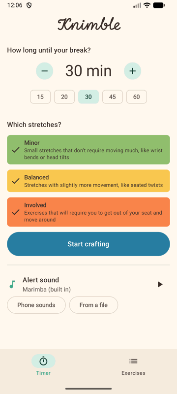
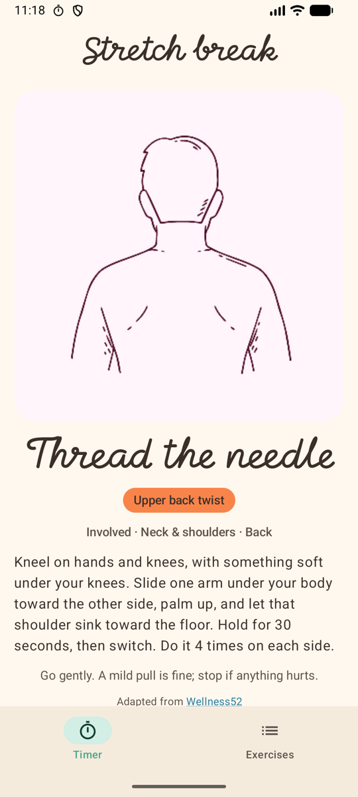
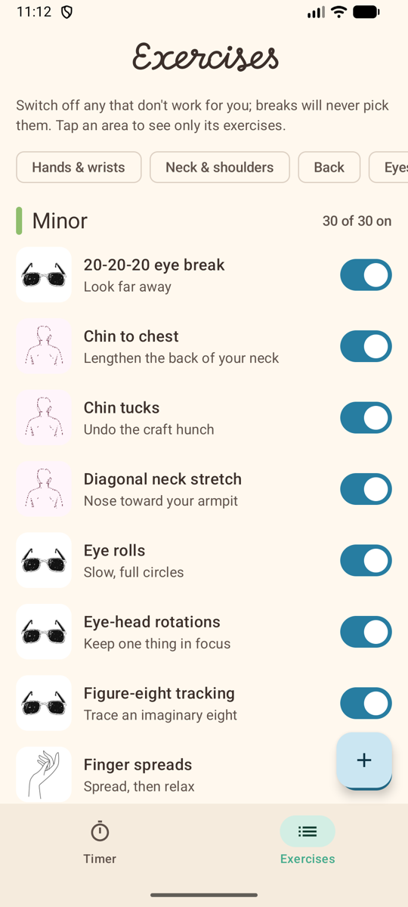
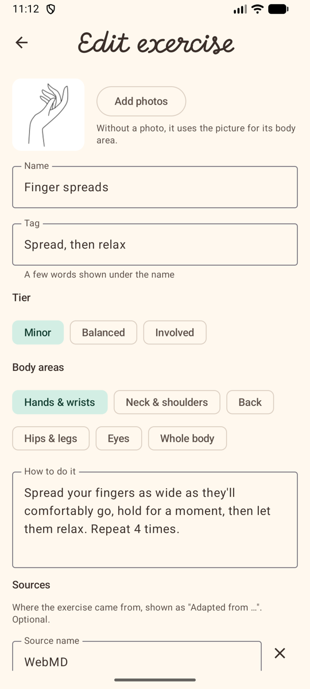

# Knimble

A timer for crafters. Start it when you sit down to knit, crochet, sew or draw, and when it ends Knimble
reminds you to take a stretch break and gives you a random stretch to do. Kotlin + Jetpack Compose.



<p>
  
  
  
  
</p>

## What it does

- **Timer:** pick how long until your break and which kinds of stretches you're up for: **Minor** (small
  moves you can do in your seat), **Balanced** (a little more movement) or **Involved** (get up and move
  around).
- **Break alert:** when the timer ends, Knimble plays a short sound and repeats it every minute until you
  open the break. The alert sound can be the built-in marimba, one of your phone's sounds, or a file of your
  own.
- **Break screen:** shows a random exercise from the tiers you chose, with a picture, instructions and its
  sources. Ask for a different one, go back to crafting, or finish the break.
- **Exercise index:** every exercise, grouped by tier, filterable by body area (hands & wrists, neck &
  shoulders, back, hips & legs, eyes, whole body). Switch off any that don't work for you and breaks will
  never pick them.
- **Your own exercises:** add new exercises or edit any existing one: name, a short tag, tier, body areas,
  instructions, sources, and up to five photos.

This is a personal project for me and friends, not medical advice. The exercises are gentle stretches adapted
from public health sites and a doctor's exercise sheet. Go gently, and stop if anything hurts.

## Build

```
./gradlew assembleDebug
./gradlew test
./gradlew connectedAndroidTest   # needs a device or emulator; includes a ~2 minute real-alarm test
```

## Credits

- Exercise sources: [docs/EXERCISE_SOURCES.md](docs/EXERCISE_SOURCES.md)
- Sounds: [docs/SOUND_CREDITS.md](docs/SOUND_CREDITS.md)
- Title font: MoMo Signature, SIL Open Font License ([docs/fonts](docs/fonts))
- Pictures (placeholders for now): [docs/IMAGE_CREDITS.md](docs/IMAGE_CREDITS.md)
